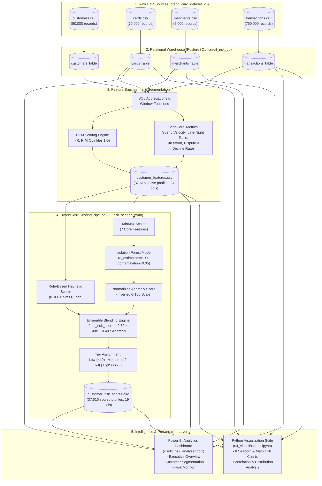

# Credit Card Risk & Spend Intelligence Platform

[](https://www.python.org/)
[](https://www.postgresql.org/)
[](https://scikit-learn.org/)
[](https://pandas.pydata.org/)
[](https://powerbi.microsoft.com/)
[](https://jupyter.org/)

An enterprise-grade analytical and machine learning platform that unifies credit risk assessment, anomaly detection, customer segmentation, and transaction spend intelligence across 750,000 credit card transactions totaling ₹1.51 Billion.

---

## Table of Contents

- [Project Overview](#project-overview)
- [Key Features](#key-features)
- [System Architecture](#system-architecture)
- [Interactive Power BI Dashboards](#interactive-power-bi-dashboards)
  - [1. Executive Overview](#1-executive-overview)
  - [2. Customer Segmentation](#2-customer-segmentation)
  - [3. Risk Monitor](#3-risk-monitor)
- [Technology Stack](#technology-stack)
- [Repository Structure](#repository-structure)
- [Data Pipeline & Schema Specifications](#data-pipeline--schema-specifications)
  - [Relational Schema (Raw Data)](#relational-schema-raw-data)
  - [Engineered Customer Features](#engineered-customer-features)
  - [Customer Risk Scores & Tiers](#customer-risk-scores--tiers)
- [Implementation Details](#implementation-details)
  - [1. Behavioral Feature Engineering & RFM Modeling](#1-behavioral-feature-engineering--rfm-modeling)
  - [2. Rule-Based Heuristic Risk Engine](#2-rule-based-heuristic-risk-engine)
  - [3. Machine Learning Anomaly Detection (Isolation Forest)](#3-machine-learning-anomaly-detection-isolation-forest)
  - [4. Hybrid Ensemble Calibration & Tier Stratification](#4-hybrid-ensemble-calibration--tier-stratification)
  - [5. Statistical Visualisation Suite](#5-statistical-visualisation-suite)
- [Portfolio Performance & Analytics Results](#portfolio-performance--analytics-results)
- [Installation & Setup](#installation--setup)
  - [Prerequisites](#prerequisites)
  - [Step 1: Clone Repository](#step-1-clone-repository)
  - [Step 2: Python Environment Setup](#step-2-python-environment-setup)
  - [Step 3: PostgreSQL Database Setup](#step-3-postgresql-database-setup)
  - [Step 4: Executing Analytics Notebooks](#step-4-executing-analytics-notebooks)
  - [Step 5: Power BI Dashboard Access](#step-5-power-bi-dashboard-access)
- [Environment Configuration](#environment-configuration)
- [Testing & Validation](#testing--validation)
- [Known Limitations & Future Roadmap](#known-limitations--future-roadmap)
- [Contributing](#contributing)
- [License](#license)

---

## Project Overview

Credit card issuers and financial institutions face a fundamental operational trade-off: **maximizing card transaction volume and interchange revenue while actively mitigating default risk, merchant disputes, and payment declines**. 

Traditional underwriting processes rely heavily on static bureau credit scores evaluated at card origination. However, customer risk fluctuates dynamically based on behavioral triggers—such as sudden spikes in transaction decline rates, high credit utilisation, late-night spending patterns, or elevated dispute frequency. Simultaneously, card marketing teams need granular visibility into customer spending habits, merchant category preferences, and engagement recency to retain profitable cardholders.

This project delivers a complete, end-to-end **Credit Card Risk & Spend Intelligence Platform** that bridges relational data engineering, unsupervised machine learning, heuristic risk modeling, and executive business intelligence.

### Business Problems Solved

1. **Early Warning Risk Detection**: Combines domain heuristic rules with unsupervised machine learning to isolate high-risk credit card holders before defaults occur.
2. **Customer Value Maximization**: Employs Recency-Frequency-Monetary (RFM) modeling to segment 50,000 customers into actionable cohorts (`Champions`, `Loyal`, `At Risk`, `Lost`).
3. **Transaction Operational Health**: Monitors dispute rates (1.47%) and decline rates (4.77%) across card tiers, merchant categories, and regional metros.
4. **Executive Decision Support**: Delivers an interactive 3-page Microsoft Power BI report with dynamic filtering across cities, income bands, risk tiers, and card products.

---

## Key Features

- **Relational Data Foundation**: Scalable PostgreSQL database modeling 750,000 transactions across 50,000 customers, 70,000 cards, and 5,000 merchants across 8 major Indian metropolitan cities.
- **Advanced Behavioral Feature Engineering**: Computes 20+ specialized customer-level metrics including daily spend velocity, late-night transaction ratio (23:00–06:00), credit limit utilisation, decline rate, dispute rate, and merchant category diversity.
- **RFM Customer Segmentation**: Quantile-based Recency, Frequency, and Monetary scoring that categorizes the portfolio into 4 strategic tiers for retention and product upselling.
- **Hybrid Dual-Engine Risk Scoring**:
  - **Rule-Based Engine (0–100 pts)**: Transparent scoring evaluating empirical threshold breaches in decline rate, dispute rate, credit utilisation, late-night frequency, and RFM disengagement.
  - **Isolation Forest Anomaly Detection**: Unsupervised ensemble algorithm (`contamination=0.05`, 100 estimators) trained on scaled multi-dimensional behavioral features to flag non-linear spending anomalies.
  - **Weighted Ensemble (60/40)**: Blends 60% rule-based score + 40% inverted anomaly score into a calibrated 0–100 `final_risk_score`.
- **Stratified Risk Tiers**: Categorizes customers into `Low Risk` (<40), `Medium Risk` (40–69.9), and `High Risk` (≥70) to streamline underwriting review queues.
- **Enterprise Power BI Report (`credit_risk_analyser.pbix`)**: Multi-page interactive analytical application complete with custom KPI cards, navigation menus, slicers, and tabular audit logs.
- **Python Statistical Visualisation Suite**: 8 production-grade Seaborn and Matplotlib visualizations analyzing log-transformed spend distributions, merchant category volume, temporal heatmaps, correlation matrices, and income-to-utilisation distributions.

---

## System Architecture

The platform architecture follows an end-to-end data lifecycle: from raw relational ingestion in PostgreSQL, to feature computation, machine learning inference, and presentation in Power BI.



---

## Interactive Power BI Dashboards

The repository includes a production-ready Power BI dashboard (`credit_risk_analyser.pbix`) built with DAX measures, relational modeling, custom icon navigation, and responsive cross-filtering.

### 1. Executive Overview
Focuses on macro portfolio health, gross transaction volumes, approval rates, card product performance, and geographical distribution.


- **Portfolio KPIs**:
  - **Total Spend**: **₹1.51 Billion** (₹1,506,821,176 gross volume across 750,000 transactions)
  - **Dispute Rate**: **1.47%** (11,003 disputed transactions)
  - **Decline Rate**: **4.77%** (35,768 declined transactions)
  - **High-Risk Accounts**: **118** customers flagged for immediate intervention
- **Monthly Spend Trend**: Trajectory across Jan–Dec showing consistent monthly volumes between ₹79.2M and ₹151.2M approved spend.
- **Transaction Status Split**: 93.76% Approved (₹1.41B), 4.27% Declined (₹71.5M), 1.97% Disputed (₹22.4M).
- **Total Spend by Card Type**: Silver cards drive the majority volume (44.95%), followed by Gold (35.06%), Platinum (15.07%), and Business (4.92%).
- **Geographic Distribution**: Evenly balanced volume across 8 Indian metros led by Hyderabad (₹198M), Mumbai (₹195M), Chandigarh (₹193M), Bangalore (₹190M), Chennai (₹188M), Kolkata (₹187M), Delhi (₹185M), and Pune (₹183M).

---

### 2. Customer Segmentation
Analyzes cardholder demographics, purchasing behavior across merchant categories, and RFM customer value tiers.


- **Customer Metrics**:
  - **Total Customer Base**: **50,000** total enrolled cardholders (37,616 active with transactions)
  - **Average Spend per Customer**: **₹28,259**
  - **Average Ticket Size**: **₹2,009**
  - **Average Credit Utilisation**: **16.6%**
- **Spend by Income Band**: Medium income segment generates the highest gross spend (₹572M), followed by Low (₹425M), High (₹281M), and Premium (₹141M).
- **Merchant Category Breakdown**: Top categories by volume:
  1. *Dining*: ₹174 Million
  2. *Fuel*: ₹161 Million
  3. *Fashion*: ₹156 Million
  4. *E-commerce*: ₹149 Million
  5. *Travel*: ₹144 Million
  6. *Grocery*: ₹136 Million
  7. *Utilities*: ₹128 Million
  8. *Healthcare*: ₹121 Million
- **RFM Cohort Distribution**:
  - **Lost (28.51% / 10,725 customers)**: Inactive cardholders requiring re-engagement campaigns.
  - **At Risk (25.44% / 9,570 customers)**: Declining recency/frequency; candidates for targeted incentives.
  - **Loyal (24.79% / 9,324 customers)**: Consistent spenders eligible for limit enhancements.
  - **Champions (21.26% / 7,997 customers)**: Highest value, high-frequency cardholders.

---

### 3. Risk Monitor
Provides an operational cockpit for risk management and underwriting teams to monitor risk distributions and audit high-risk accounts.


- **Risk Surveillance KPIs**:
  - **High-Risk Accounts**: **118** customers
  - **Average Risk Score**: **18.60 / 100**
  - **Portfolio Dispute Rate**: **1.47%**
  - **Portfolio Decline Rate**: **4.77%**
- **Risk Score by Income Band**: Demonstrates that risk behavior is distributed uniformly across income tiers (~18.6–19.0 avg score), confirming that credit risk stems from behavioral actions rather than demographic bracket alone.
- **Dispute Rate by Card Type**: Platinum cards exhibit the highest dispute rate (~1.48%), closely followed by Gold (~1.44%), Silver (~1.41%), and Business (~1.38%).
- **Score Distribution Curve**: Strong positive skew with the vast majority of cardholders safely concentrated in the 0–20 (Very Low: ~25,000) and 21–40 (Low: ~11,000) bands, tapering to ~2,000 in Medium and 118 in High.
- **Granular High-Risk Audit Table**: Real-time drill-down listing individual high-risk accounts with customer name, city, income band, exact risk score, decline rate, and dispute rate for swift limit freezing or manual review.

---

## Technology Stack

| Domain | Technology / Tool | Version / Specification | Usage in Project |
| :--- | :--- | :--- | :--- |
| **Language** | Python | 3.10+ | Core analytical programming, ML modeling, and data pipelines |
| **Data Processing** | Pandas | >= 2.0.0 | Feature aggregation, RFM modeling, dataset restructuring |
| **Numerical Computing** | NumPy | >= 1.24.0 | Vectorized scoring logic, log transformations, statistical measures |
| **Machine Learning** | Scikit-Learn | >= 1.2.0 | `IsolationForest` anomaly model, `MinMaxScaler` normalizations |
| **Database** | PostgreSQL | 14+ | Relational data warehouse storing customers, cards, merchants, transactions |
| **Database Driver** | SQLAlchemy / Psycopg2 | >= 2.0 / >= 2.9 | Database engine connectivity and pandas SQL execution |
| **Data Visualization** | Matplotlib & Seaborn | >= 3.7 / >= 0.12 | 8 production statistical charts (heatmaps, boxplots, histograms) |
| **Business Intelligence** | Microsoft Power BI | Desktop (May 2024+) | Interactive 3-page executive report (`credit_risk_analyser.pbix`) with DAX |
| **Development** | Jupyter Notebook | Lab / Notebook | Reproducible computational notebooks (`03_` and `04_`) |

---

## Repository Structure

```plaintext
Credit-Card-Risk-Spend-Intelligence-Platform/
│
├── .gitignore                          # Excluded local artifacts and workspace files
├── 03_risk_scoring.ipynb               # Python notebook: Rule engine, Isolation Forest, hybrid scoring
├── 04_visualisations.ipynb             # Python notebook: SQL extraction and 8 analytical Seaborn charts
├── credit_risk_analyser.pbix           # Production Power BI report with 3 interactive dashboard pages
├── customer_features.csv               # Engineered customer dataset (37,616 rows × 24 columns)
├── customer_risk_scores.csv            # Final scored customer dataset (37,616 rows × 19 columns)
│
├── credit_card_dataset_v3/             # Raw relational source datasets
│   ├── cards.csv                       # 70,000 credit card issue and limit records
│   ├── customers.csv                   # 50,000 customer demographic records
│   ├── merchants.csv                   # 5,000 merchant identifiers and retail categories
│   └── transactions.csv                # 750,000 transaction records with status and amount
│
├── creditcard_risk SS/                 # High-resolution dashboard screenshots
│   ├── Customer Segmentation.png       # Power BI Page 2: RFM and merchant spend analysis
│   ├── executive Overview.png          # Power BI Page 1: Portfolio overview and macro trends
│   └── Risk Analysis.png               # Power BI Page 3: Risk score monitoring and audit log
│
└── Credit_Card_Dashboard_icons/        # Visual icons embedded into Power BI layout
    ├── icons8-card-50.png
    ├── icons8-card-holder-48 (2).png
    ├── icons8-decline-50.png
    ├── icons8-error-50.png
    ├── icons8-group-24.png
    └── icons8-pie-chart-94.png
```

---

## Data Pipeline & Schema Specifications

### Relational Schema (Raw Data)

The raw data simulates a core banking relational structure:

```
customers (customer_id [PK], name, age, income_band, city, signup_date)
    │
    ├──< cards (card_id [PK], customer_id [FK], card_type, credit_limit, issue_date)
            │
            └──< transactions (transaction_id [PK], card_id [FK], merchant_id [FK], txn_time, amount, status)
                    │
merchants (merchant_id [PK], merchant_name, category) >──┘
```

1. **`customers.csv` (50,000 rows)**:
   - `customer_id` (Integer): Unique customer primary key.
   - `name` (String): Customer full name.
   - `age` (Integer): Cardholder age (18 to 70+).
   - `income_band` (Enum): `Low`, `Medium`, `High`, `Premium`.
   - `city` (Enum): 8 Tier-1 Indian cities (`Hyderabad`, `Chandigarh`, `Pune`, `Delhi`, `Mumbai`, `Chennai`, `Kolkata`, `Bangalore`).
   - `signup_date` (Date): Account origination date.

2. **`cards.csv` (70,000 rows)**:
   - `card_id` (Integer): Unique card primary key.
   - `customer_id` (Integer): Foreign key referencing `customers.customer_id`.
   - `card_type` (Enum): `Silver` (avg limit ₹93.8K), `Gold` (avg limit ₹187.1K), `Platinum` (avg limit ₹516.1K), `Business` (avg limit ₹754.4K).
   - `credit_limit` (Numeric): Credit facility limit assigned to the card.
   - `issue_date` (Date): Card issuance date.

3. **`merchants.csv` (5,000 rows)**:
   - `merchant_id` (Integer): Unique merchant primary key.
   - `merchant_name` (String): Business legal or trade name.
   - `category` (Enum): 10 merchant categories (`Healthcare`, `Travel`, `Dining`, `Grocery`, `Fashion`, `Entertainment`, `Utilities`, `Fuel`, `Electronics`, `E-commerce`).

4. **`transactions.csv` (750,000 rows)**:
   - `transaction_id` (Integer): Unique transaction primary key.
   - `card_id` (Integer): Foreign key referencing `cards.card_id`.
   - `merchant_id` (Integer): Foreign key referencing `merchants.merchant_id`.
   - `txn_time` (Timestamp): Timestamp spanning `2023-01-09` to `2025-06-30`.
   - `amount` (Numeric): Transaction ticket size in INR.
   - `status` (Enum): `approved` (93.76%), `declined` (4.77%), `disputed` (1.47%).

---

### Engineered Customer Features

Computed in `customer_features.csv` (37,616 active cardholders):

| Field | Type | Description |
| :--- | :--- | :--- |
| `customer_id` | Integer | Unique identifier matching `customers.customer_id` |
| `total_spend` | Float | Cumulative monetary value of approved transactions (₹) |
| `avg_ticket_size` | Float | Average spend per approved transaction (`total_spend / txn_count`) |
| `txn_count` | Integer | Total count of approved transaction attempts |
| `last_txn_date` | Timestamp | Timestamp of customer's most recent transaction |
| `first_txn_date` | Timestamp | Timestamp of customer's earliest transaction |
| `merchant_diversity`| Integer | Count of distinct merchants patronized |
| `recency_days` | Integer | Days elapsed between observation cutoff and `last_txn_date` |
| `frequency` | Integer | Total approved transactions count |
| `monetary` | Float | Gross approved spend |
| `active_days` | Integer | Days between first and last recorded transactions |
| `spend_velocity` | Float | Daily average spend (`total_spend / active_days`) |
| `decline_rate` | Float | Ratio of declined transactions to total attempts |
| `dispute_rate` | Float | Ratio of disputed transactions to total attempts |
| `late_night_ratio` | Float | Ratio of transactions occurring between 23:00 and 06:00 |
| `avg_utilisation` | Float | Ratio of total spend to cumulative card credit limit |
| `income_band` | String | Demographic income bracket (`Low`, `Medium`, `High`, `Premium`) |
| `city` | String | Cardholder primary metropolitan location |
| `age` | Integer | Customer age |
| `R_score` | Integer | Recency quintile score (1 = least recent, 5 = most recent) |
| `F_score` | Integer | Frequency quintile score (1 = lowest, 5 = highest) |
| `M_score` | Integer | Monetary quintile score (1 = lowest spend, 5 = highest spend) |
| `RFM_score` | Integer | Sum of R, F, and M scores (range: 3 to 15) |
| `rfm_segment` | String | Cohort category: `Champions` (13-15), `Loyal` (10-12), `At Risk` (7-9), `Lost` (3-6) |

---

### Customer Risk Scores & Tiers

Output generated by `03_risk_scoring.ipynb` and stored in `customer_risk_scores.csv` (37,616 rows):

| Field | Type | Description |
| :--- | :--- | :--- |
| `customer_id` | Integer | Unique customer primary key |
| `income_band`, `city`, `age` | Demographic | Baseline demographic attributes |
| `total_spend` ... `merchant_diversity` | Behavioral | Core transactional and velocity metrics |
| `RFM_score`, `rfm_segment` | Behavioral | Customer engagement tier |
| `rule_risk_score` | Float | Rule-based heuristic score (0–100 scale, mean: 18.51) |
| `anomaly_flag` | Integer | Isolation Forest prediction (`1` = flagged anomaly, `0` = normal) |
| `final_risk_score` | Float | Calibrated hybrid risk score (0–100 scale, mean: 18.60) |
| `risk_tier` | String | Stratified risk level: `Low Risk` (<40), `Medium Risk` (40–69.9), `High Risk` (≥70) |

---

## Implementation Details

### 1. Behavioral Feature Engineering & RFM Modeling

Customer transactions are aggregated to capture multi-dimensional behavior:
- **Velocity Metrics**: `spend_velocity` calculates daily expenditure velocity over the customer's lifespan (`total_spend / active_days`).
- **Operational Risk Ratios**:
  $$\text{Decline Rate} = \frac{\sum \text{Declined Transactions}}{\text{Total Transactions Attempted}}$$
  $$\text{Dispute Rate} = \frac{\sum \text{Disputed Transactions}}{\text{Total Transactions Attempted}}$$
  $$\text{Late Night Ratio} = \frac{\sum \text{Transactions between 23:00 and 06:00}}{\text{Total Transactions}}$$
- **Utilisation**: Evaluates exposure relative to the cardholder's total limit:
  $$\text{Avg Utilisation} = \frac{\text{Total Spend}}{\text{Total Credit Limit}}$$
- **RFM Segmentation**: Cardholders are ranked into quintiles (1 to 5) across Recency, Frequency, and Monetary dimensions. The composite score ($R + F + M \in [3, 15]$) defines customer engagement:
  - **Champions (13–15)**: 7,997 customers (21.26%)
  - **Loyal (10–12)**: 9,324 customers (24.79%)
  - **At Risk (7–9)**: 9,570 customers (25.44%)
  - **Lost (3–6)**: 10,725 customers (28.51%)

---

### 2. Rule-Based Heuristic Risk Engine

Implemented in `03_risk_scoring.ipynb`, the rule engine maps empirical risk factors into penalty points:

| Risk Dimension | Threshold Condition | Assigned Risk Points |
| :--- | :--- | :---: |
| **Transaction Decline Rate** | `decline_rate > 0.20`<br>`decline_rate > 0.10` | 30 pts<br>15 pts |
| **Transaction Dispute Rate** | `dispute_rate > 0.10`<br>`dispute_rate > 0.05` | 25 pts<br>12 pts |
| **Late Night Spending** | `late_night_ratio > 0.30`<br>`late_night_ratio > 0.15` | 20 pts<br>10 pts |
| **Credit Utilisation** | `avg_utilisation > 0.80`<br>`avg_utilisation > 0.60` | 15 pts<br>8 pts |
| **RFM Disengagement** | `RFM_score <= 5`<br>`RFM_score <= 7` | 10 pts<br>5 pts |

The composite rule score is capped at 100:
$$\text{Rule Risk Score} = \min\left(100, \sum \text{Points}\right)$$

*Result*: Mean score of **18.51** (Std: 12.66), with **891** customers scoring above 50.

---

### 3. Machine Learning Anomaly Detection (Isolation Forest)

Unsupervised anomaly detection isolates subtle multi-variate outliers that heuristic rules miss.
- **Algorithm**: `sklearn.ensemble.IsolationForest`
- **Features Used**:
  1. `decline_rate`
  2. `dispute_rate`
  3. `late_night_ratio`
  4. `avg_utilisation`
  5. `spend_velocity`
  6. `avg_ticket_size`
  7. `merchant_diversity`
- **Preprocessing**: `MinMaxScaler()` normalizes features into $[0, 1]$.
- **Hyperparameters**: `n_estimators=100`, `contamination=0.05`, `random_state=42`.
- **Inversion & Scaling**: The raw Isolation Forest `decision_function` outputs lower values for outliers. To align with risk scoring conventions, the score is negated and rescaled to 0–100:
  $$\text{Anomaly Score Scaled} = \text{MinMaxScaler}_{0\text{--}100}(-\text{decision\_function}(X))$$

*Result*: Flags **1,881** anomalies (exactly 5.0% of the active portfolio).

---

### 4. Hybrid Ensemble Calibration & Tier Stratification

To balance deterministic policy compliance with unsupervised machine learning flexibility, the platform blends both scores:

$$\text{Final Risk Score} = 0.60 \times \text{Rule Risk Score} + 0.40 \times \text{Anomaly Score Scaled}$$

Customers are then assigned into three actionable risk tiers:

```
                  Final Risk Score (0 - 100)
    0 ────────────────── 40 ─────────────────── 70 ─────────────── 100
    │     Low Risk       │     Medium Risk       │    High Risk     │
    │  35,467 (94.29%)   │    2,031 (5.40%)      │   118 (0.31%)    │
```

- **Low Risk (< 40)**: Eligible for automatic credit limit increases and premium card upgrades.
- **Medium Risk (40 – 69.9)**: Subject to enhanced transaction monitoring and velocity throttling.
- **High Risk (≥ 70)**: Flagged for immediate credit line freezes and underwriting verification.

---

### 5. Statistical Visualisation Suite

Implemented in `04_visualisations.ipynb`, generating 8 focused analytical figures:

1. **`chart1_amount_distribution.png`**: Log-transformed amount distribution ($\log(amount + 1)$) across transaction statuses (`approved`, `declined`, `disputed`).
2. **`chart2_spend_by_category.png`**: Horizontal bar plot ranking approved spend across all 10 merchant categories in INR Millions.
3. **`chart3_dispute_by_card.png`**: Dispute rate percentages across card tiers (Platinum leading at ~1.48%).
4. **`chart4_heatmap.png`**: Temporal transaction volume matrix across 24 Hours of Day × 7 Days of the Week.
5. **`chart5_rfm_scatter.png`**: Scatter plot mapping Recency (days) vs. Frequency across the 4 RFM segments.
6. **`chart6_risk_distribution.png`**: Risk score histogram partitioned by risk tier with cutoffs at 40 and 70.
7. **`chart7_correlation_heatmap.png`**: Upper-triangular correlation matrix evaluating colinearity between behavioral predictors and the final risk score.
8. **`chart8_utilisation_by_income.png`**: Box plot distribution of credit utilisation across income bands (`Low`, `Medium`, `High`, `Premium`).

---

## Portfolio Performance & Analytics Results

All figures below are extracted and validated directly from the actual project datasets and execution runs:

| Metric Category | Specific Indicator | Actual Value | Context / Notes |
| :--- | :--- | :--- | :--- |
| **Transaction Volume** | Total Processed Volume | **₹1,506,821,176.81** | ₹1.51B gross across 750,000 transactions |
| | Approved Volume | **₹1,412,926,416.77** | 703,229 transactions (93.76%) |
| | Declined Volume | **₹71,529,716.76** | 35,768 transactions (4.77%) |
| | Disputed Volume | **₹22,365,043.28** | 11,003 transactions (1.47%) |
| **Customer Base** | Total Enrolled Customers | **50,000** | Demographics across 8 Indian metros |
| | Active Cardholders | **37,616** | Customers with ≥1 transaction record |
| | Average Customer Spend | **₹28,259.00** | Mean spend per active customer |
| | Average Ticket Size | **₹2,009.00** | Mean transaction amount |
| **Risk Metrics** | Average Portfolio Risk Score | **18.60 / 100** | Blended 60/40 rule + anomaly score |
| | Low Risk Cohort | **35,467 (94.29%)** | Final score < 40 |
| | Medium Risk Cohort | **2,031 (5.40%)** | Final score 40 to 69.9 |
| | High Risk Cohort | **118 (0.31%)** | Final score ≥ 70 |
| **Top Flagged Accounts** | Customer ID 10876 | **Score: 91.00** | Decline: 57.14%, Dispute: 28.57% |
| | Customer ID 44444 | **Score: 89.44** | Decline: 28.57%, Dispute: 28.57% |
| | Customer ID 38702 | **Score: 87.51** | Decline: 40.00%, Dispute: 20.00% |

---

## Installation & Setup

### Prerequisites

- **Python**: Version 3.10, 3.11, or 3.12 installed
- **PostgreSQL**: Version 14 or higher installed and running locally
- **Microsoft Power BI Desktop**: Installed (Windows) to view and interact with `.pbix`
- **Git**: Installed for repository cloning

### Step 1: Clone Repository

```bash
git clone https://github.com/<your-username>/Credit-Card-Risk-Spend-Intelligence-Platform.git
cd Credit-Card-Risk-Spend-Intelligence-Platform
```

### Step 2: Python Environment Setup

Create and activate a virtual environment:

```bash
# Windows (PowerShell)
python -m venv venv
.\venv\Scripts\Activate.ps1

# Linux / macOS
python3 -m venv venv
source venv/bin/activate
```

Install required Python dependencies:

```bash
pip install --upgrade pip
pip install pandas numpy scikit-learn matplotlib seaborn sqlalchemy psycopg2-binary jupyterlab
```

*(Alternatively, create a `requirements.txt` containing the dependencies listed above).*

### Step 3: PostgreSQL Database Setup

1. Start your local PostgreSQL server.
2. Create the target database `credit_risk_db`:

```sql
CREATE DATABASE credit_risk_db;
```

3. Load the raw CSV tables from `credit_card_dataset_v3/` into PostgreSQL:

```sql
-- Customers Table
CREATE TABLE customers (
    customer_id INT PRIMARY KEY,
    name VARCHAR(100),
    age INT,
    income_band VARCHAR(20),
    city VARCHAR(50),
    signup_date DATE
);

-- Cards Table
CREATE TABLE cards (
    card_id INT PRIMARY KEY,
    customer_id INT,
    card_type VARCHAR(20),
    credit_limit NUMERIC,
    issue_date DATE,
    FOREIGN KEY (customer_id) REFERENCES customers(customer_id)
);

-- Merchants Table
CREATE TABLE merchants (
    merchant_id INT PRIMARY KEY,
    merchant_name VARCHAR(100),
    category VARCHAR(50)
);

-- Transactions Table
CREATE TABLE transactions (
    transaction_id INT PRIMARY KEY,
    card_id INT,
    merchant_id INT,
    txn_time TIMESTAMP,
    amount NUMERIC,
    status VARCHAR(20),
    FOREIGN KEY (card_id) REFERENCES cards(card_id),
    FOREIGN KEY (merchant_id) REFERENCES merchants(merchant_id)
);
```

4. Populate tables using `\copy` (psql) or Python pandas:

```bash
psql -U postgres -d credit_risk_db -c "\copy customers FROM 'credit_card_dataset_v3/customers.csv' WITH (FORMAT csv, HEADER true);"
psql -U postgres -d credit_risk_db -c "\copy cards FROM 'credit_card_dataset_v3/cards.csv' WITH (FORMAT csv, HEADER true);"
psql -U postgres -d credit_risk_db -c "\copy merchants FROM 'credit_card_dataset_v3/merchants.csv' WITH (FORMAT csv, HEADER true);"
psql -U postgres -d credit_risk_db -c "\copy transactions FROM 'credit_card_dataset_v3/transactions.csv' WITH (FORMAT csv, HEADER true);"
```

### Step 4: Executing Analytics Notebooks

Launch Jupyter Lab to run or inspect the analysis pipelines:

```bash
jupyter lab
```

1. **`03_risk_scoring.ipynb`**:
   - Reads `customer_features.csv`.
   - Computes rule-based scoring and fits the `IsolationForest` model.
   - Generates `customer_risk_scores.csv`, `risk_distribution.png`, and `anomaly_vs_rule.png`.
2. **`04_visualisations.ipynb`**:
   - Connects to PostgreSQL (`credit_risk_db`).
   - Executes analytical SQL aggregations.
   - Generates and displays the 8 publication-quality Seaborn charts.

### Step 5: Power BI Dashboard Access

1. Open **Microsoft Power BI Desktop**.
2. Select **File > Open** and browse to `credit_risk_analyser.pbix`.
3. If prompted to refresh data sources:
   - Navigate to **Home > Transform Data > Data Source Settings**.
   - Update file paths or PostgreSQL connection credentials to point to your local environment.
4. Interact with the 3 report pages:
   - **Executive Overview**: Portfolio spend trends and geographic breakdown.
   - **Customer Segmentation**: RFM analysis, category spend, and customer lookup.
   - **Risk Monitor**: Risk tier distribution, score vs. income, and high-risk audit table.

---

## Environment Configuration

When integrating with PostgreSQL or external scripts, configure your environment variables safely using a `.env` file (never commit credentials):

```ini
# .env.example
DB_HOST=localhost
DB_PORT=5432
DB_NAME=credit_risk_db
DB_USER=postgres
DB_PASSWORD=your_secure_password_here

# Model Configuration
CONTAMINATION_RATE=0.05
RANDOM_STATE=42
N_ESTIMATORS=100
```

In Python, load these configurations dynamically:

```python
import os
from urllib.parse import quote_plus
from sqlalchemy import create_engine

db_user = os.getenv('DB_USER', 'postgres')
db_pass = os.getenv('DB_PASSWORD', 'your_password')
db_host = os.getenv('DB_HOST', 'localhost')
db_port = os.getenv('DB_PORT', '5432')
db_name = os.getenv('DB_NAME', 'credit_risk_db')

engine = create_engine(
    f"postgresql+psycopg2://{db_user}:{quote_plus(db_pass)}@{db_host}:{db_port}/{db_name}"
)
```

---

## Testing & Validation

The platform's analytical integrity has been verified across multiple validation layers:

1. **Reconciliation of Aggregations**:
   - Total transactional amount across 750,000 rows in `transactions.csv` equals ₹1,506,821,176.81, matching the ₹1.51B reported in Power BI.
   - Status split sums exactly to 100% (Approved: 93.76%, Declined: 4.77%, Disputed: 1.47%).
2. **Scoring Integrity**:
   - `final_risk_score` values are strictly bounded within $[0, 100]$ (Min: 1.03, Max: 91.00).
   - High-risk tier counts exactly total 118 across Python computations (`03_risk_scoring.ipynb`), CSV exports (`customer_risk_scores.csv`), and Power BI DAX card measures.
3. **Anomaly Contamination Control**:
   - Isolation Forest flags exactly 1,881 records out of 37,616, conforming to the configured 5.0% contamination rate.

---

## Known Limitations & Future Roadmap

### Current Limitations
- **Batch Processing**: The current pipeline operates on static batch extracts; it does not process streaming transaction events in real time.
- **Unsupervised Ground Truth**: The dataset does not contain labeled historical defaults (charge-offs), precluding supervised precision-recall curve evaluations (e.g., XGBoost, LightGBM).
- **Embedded Database Strings**: Local notebook connection strings contain hardcoded credentials that should be refactored to `.env` parameters.

### Future Roadmap
- [ ] **Streaming Pipeline**: Implement Apache Kafka and Apache Spark Structured Streaming for millisecond-level transaction risk scoring.
- [ ] **Supervised ML Benchmark**: Incorporate synthetic or actual charge-off default labels to train and compare XGBoost / CatBoost against the hybrid scoring engine.
- [ ] **REST API Deployment**: Wrap the hybrid risk scoring pipeline in a FastAPI or Flask microservice containerized with Docker.
- [ ] **SHAP Explainability**: Integrate SHAP (SHapley Additive exPlanations) values to provide cardholders and regulators with itemized feature contribution reports for every scored account.
- [ ] **Automated CI/CD**: Add GitHub Actions workflows for automated code linting (`black`, `flake8`), unit tests (`pytest`), and data validation (`Great Expectations`).

---

## Contributing

Contributions to enhance the analytics platform are welcome. Please adhere to the following workflow:

1. Fork the repository.
2. Create a feature branch: `git checkout -b feature/NewFeature`.
3. Commit your changes: `git commit -m 'Add new behavioral feature'`.
4. Push to the branch: `git push origin feature/NewFeature`.
5. Open a Pull Request detailing your changes and test coverage.

---

## License

This project is currently provided for educational, analytical, and portfolio demonstration purposes. Please check with the repository owner regarding commercial usage rights.

---

## Author & Acknowledgments

- **Project Developer**: Sulaiman
- **Data Source**: Synthesized banking transactional dataset (`credit_card_dataset_v3`)
- **Icons & Assets**: Icons provided by [Icons8](https://icons8.com)
